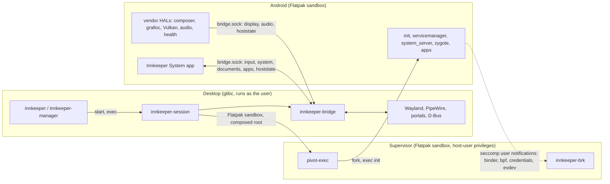

# Architecture

Innkeeper runs a near-stock AOSP userspace (ART, system_server, SurfaceFlinger)
as ordinary host processes in a rootless, on-demand session. Our code sits at
Android's stable boundaries, so routine work never needs an AOSP build.

## Three runtime zones

- **Desktop.** The CLI and manager install and launch apps through
  `innkeeper-core`; the launcher assembles and starts the session; the bridge is
  the only process that talks to the desktop.
- **Supervisor.** One seccomp filter on Android's init traps what the sandbox
  can't do (binder, eBPF, single-uid credentials, session-local evdev). The Rust
  broker defines the filter and serves every notification. The static pivot-exec
  bootstrap sets up the root, then becomes the broker, which also reaps
  children. See [supervisor/README.md](../supervisor/README.md).
- **Android.** The pinned image plus our overlay layer, vendor HALs and the
  privileged system app. See [android/README.md](../android/README.md).

The channels between zones are the seccomp notification fd and one socket,
`bridge.sock` ([bridge-protocol.md](bridge-protocol.md)). The bridge also writes
input records to the broker's private `evdev.sock`. Nothing in Android reaches
the desktop any other way, apart from `/dev/dri`, `/dev/udmabuf` and the host
network ([session.md](session.md)).

## Modules

What each directory builds and where it runs.
[tools/build/artifacts.toml](../tools/build/artifacts.toml) lists what each
module stages.

| Dir                                                             | Artifact                                              | Runs                                                          | Start reading at                |
| --------------------------------------------------------------- | ----------------------------------------------------- | ------------------------------------------------------------- | ------------------------------- |
| [host/core](../host/core/README.md)                             | `innkeeper-core` (library)                            | inside the CLI, manager and bridge                            | `src/ops.rs`                    |
| [host/cli](../host/cli/README.md)                               | `bin/innkeeper`                                       | desktop, as you                                               | `src/main.rs`                   |
| [host/manager](../host/manager/README.md)                       | `bin/innkeeper-manager`                               | desktop, as you                                               | `src/window.rs`                 |
| [host/bridge](../host/bridge/README.md)                         | `libexec/innkeeper/innkeeper-bridge`                  | desktop, in the session's sandbox                             | `src/main.rs`, `src/ipc/`       |
| [host/launcher](../host/launcher/README.md)                     | `libexec/innkeeper/innkeeper-session`                 | Flatpak sandbox                                               | `src/cli.rs`                    |
| [supervisor](../supervisor/README.md)                           | `pivot-exec`, `innkeeper-brk`, `libinnkeeper_shim.so` | sandbox; the shim inside Android                              | `broker/src/notify.rs`          |
| [image](../image/README.md)                                     | image scripts, config and static tools                | desktop, when the image is prepared                           | `fetch.sh`, `pin.toml`          |
| [image/ohos](../image/ohos/README.md)                           | the OpenHarmony image pin                             | desktop, for the OpenHarmony guest                            | `fetch.sh`, `pin.toml`          |
| [guest/bridge-client](../guest/bridge-client/README.md)         | static library                                        | linked into the guests' composers, Android's audio and health | `bridge_client.c`               |
| [ohos](../ohos/README.md)                                       | experimental OpenHarmony guest: layer, shim, runner   | test sandbox (not in the stage)                               | `sandbox.sh`, `run.py`          |
| [android/vendor/graphics](../android/vendor/graphics/README.md) | allocator, mapper, composer                           | Android `/vendor`                                             | `composer/Display.cpp`          |
| [android/vendor/vulkan](../android/vendor/vulkan/README.md)     | `vulkan.radv.so`, `vulkan.anv.so`, `vulkan.lvp.so`    | Android, in every Vulkan user                                 | `build.sh`, `patches/mesa/`     |
| [android/vendor/audio](../android/vendor/audio/README.md)       | `libtinyalsav2.so`                                    | Android, in the audio HAL                                     | `tinyalsa/pcm.c`                |
| [android/vendor/health](../android/vendor/health/README.md)     | `android.hardware.health-service.innkeeper`           | Android `/vendor`                                             | `src/battery.c`                 |
| [android/system](../android/system/README.md)                   | `innkeeper-exec`                                      | Android `/system`                                             | `exec/innkeeper-exec.c`         |
| [android/system-app](../android/system-app/README.md)           | `InnkeeperSystem.apk`                                 | Android, as a privileged app                                  | `app/.../InnkeeperSystemApp.kt` |
| [android/overlay](../android/overlay/README.md)                 | config files over the image's partitions              | Android                                                       | its README                      |
| [android/microg](../android/microg/README.md)                   | optional microG addon                                 | Android                                                       | `install.sh`                    |
| [tests](../tests/README.md)                                     | test harnesses and suites                             | desktop, never shipped                                        | its README                      |
| [packaging/flatpak](../packaging/flatpak/README.md)             | the Flatpak, `dev.sargunv.Innkeeper`                  | build time                                                    | `build.sh`                      |
| [tools](../tools/README.md)                                     | build container, staging, dev scripts                 | build time                                                    | `build/artifacts.toml`          |

## Decisions

- **Real Android userspace, not a reimplementation.** Compatibility comes from
  AOSP's own code. Reimplementing the framework (ATL, Mac.apk) means chasing
  stubs forever. A fake system_server or a SurfaceFlinger-less libgui would
  depend on unstable internals; they stay out unless measured session cost
  demands them.
- **Stable boundaries only.** HAL AIDL and stable-C interfaces, NDK APIs, rc and
  overlay files, LD_PRELOAD and seccomp at the syscall ABI. The image is never
  patched in place, and there is no AOSP patch queue; one would need a written
  reason why no stable boundary works.
- **Google's CI image, downloaded at setup.** An unmodified AOSP build from
  ci.android.com, fetched and verified on the user's machine; we never
  redistribute it ([image/README.md](../image/README.md)). No local AOSP build
  is needed.
- **Vendor code links only LL-NDK libraries** plus what we install in
  `/vendor/lib64`, and builds out of tree with the NDK.
- **Binder in userspace.** The broker serves binder from the seccomp supervisor,
  so a session needs no binderfs and no SELinux module, and it works where
  nested user namespaces are blocked.
- **The bridge owns the desktop.** The composer is a pure HWC: it hands frames
  to the bridge, which is the Wayland client (decorations, fractional scale,
  activation). Bionic code never links desktop libraries.
- **Languages by where code runs.** C or C++ for code loaded into Android
  processes or on C ABIs (HALs, the mapper and Vulkan `.so`, the shim, Mesa
  patches), kept small. Rust for standalone components, especially at trust
  boundaries (broker, bridge, launcher, host tools). Kotlin for the system app.
  Not Zig: no binder/AIDL ecosystem, and the NDK already cross-compiles C.
- **x86_64 first.** In a 47-app sample (2026-10), 77% of non-game apps ship
  x86_64 but only 14% of top games do (Unity and Unreal default to arm64), so
  ARM translation through a NativeBridge is a later milestone.

## Packaging scope

- Innkeeper ships as a Flatpak. Per-app Flatpaks are an optional extra, never a
  design constraint.
- Installing anything never needs `sudo`: no RPM/deb/AUR packages, SELinux
  modules, AppArmor profiles or kernel modules.
- `out/stage` is the installable prefix and already has the Flatpak shape: it
  becomes `/app` in the Flatpak. Every lookup is relative to the running
  executable, and runtime state lives in the XDG dirs, so dev, test and packaged
  runs share one code path.
- Inside Flatpak there are no nested user namespaces, mounts or capabilities, so
  the session runs in the app's own sandbox in single-uid mode, with a root
  built from symlinks (Flatpak's `/` is a writable tmpfs) and the host's network
  ([Flatpak mode](session.md#flatpak-mode)). No `flatpak-spawn --host`: that is
  a sandbox escape.

## Non-goals

- **Virtual machines.** Android runs as host processes integrated with the
  desktop. VM-based Android exists (the emulator, Cuttlefish, ChromeOS ARCVM); a
  VM or guest kernel is never an acceptable architecture here.
- **Play Integrity.** Banking and other apps that require it are out of scope.
- **Protection beyond desktop parity** ([security.md](security.md)).

## Alternatives and why we differ

These projects share Android components but put the host boundary in different
places. Versions below describe the sources examined in October 2026, not every
image a project has shipped.

| Project                                                                                                                                                                                       | Android userspace                                                              | Host boundary and display                                                                                                            |
| --------------------------------------------------------------------------------------------------------------------------------------------------------------------------------------------- | ------------------------------------------------------------------------------ | ------------------------------------------------------------------------------------------------------------------------------------ |
| Innkeeper                                                                                                                                                                                     | Unmodified Google AOSP 17 CI image, with our composed layers                   | Flatpak, single uid, userspace binder; trusted virtual displays feed a desktop bridge                                                |
| [Lepton](https://gitlab.steamos.cloud/frame-public/lepton/-/tree/150aba0a65daba7ff512f0d25cebf529bb9eb79e)                                                                                    | Custom Android 11 and AOSP 14 build recipes, with framework and Bionic patches | Rootless Podman, single uid, kernel binder; Waydroid-derived graphics and Steam Frame VR integration, normally one game per instance |
| [Waydroid](https://github.com/waydroid/waydroid/tree/db7294c4c2bd43157bab94cf8a3015e22d9f1ad8)                                                                                                | Custom LineageOS 20 / Android 13 system and vendor images                      | Root-managed LXC and kernel binder; Android's Wayland HWC supports full UI and multiwindow modes                                     |
| [Anbox](https://github.com/anbox/anbox/tree/ddf4c57ebbe3a2e46099087570898ab5c1e1f279) (archived)                                                                                              | Custom AOSP 7.1.1                                                              | Root-managed LXC, normally with uid mapping; emulator-derived GLES transport and task layers mapped to desktop windows               |
| [Halium](https://github.com/Halium/android/tree/43557014beee01f284ca0e70635b210d847f0f1c) / [libhybris](https://github.com/libhybris/libhybris/tree/7079712a42ea2754adf747e70c6cc75764c8596e) | Device-specific Android hardware adaptation; libhybris has no image of its own | Linux distributions reuse Android vendor drivers and services; this does not supply an Android app runtime                           |

Rootless execution and per-app windows are not unique to Innkeeper. Lepton also
uses virtual Android identities over one kernel uid, but implements them by
patching Bionic and binder libraries. Our seccomp supervisor keeps those changes
outside the image and needs neither kernel binder nor nested user namespaces.
That makes an unmodified CI image usable inside Flatpak, at the cost of owning
binder semantics and giving up kernel isolation between Android apps
([security.md](security.md#single-uid-mode)).

Waydroid's
[GBM allocator and Wayland buffer imports](https://github.com/waydroid/android_hardware_waydroid/tree/5af0c114a19fc916de837ad553524cd2aade2719)
can avoid our final frame copy, and its distinct Android uids retain file and
process isolation. Kernel binder also avoids our broker's emulation overhead.
Those are real advantages; its privileged service, image mounts and host network
setup are the installation cost. Our virtual displays avoid framework patches
for extracting task layers, but have different system-dialog behavior and retain
ImageReader buffers until host release ([display.md](display.md)). Our shared
session amortizes Android's services across apps; Lepton's separate game
instances give each game its own lifecycle and state.

Halium and libhybris solve the inverse hardware problem: running a Linux
distribution on devices whose usable drivers target Android. libhybris loads
Bionic-linked libraries into Linux processes; it does not translate ARM
instructions. We build vendor HALs and Mesa for Android and keep desktop
libraries in the host bridge, so no OEM Android driver stack is needed.

[Anbox Cloud](https://canonical.com/anbox-cloud/docs/explanation/anbox-cloud/),
unrelated to desktop Anbox, is a managed server stack that streams containerized
or VM Android instances; it serves fleets, not a local desktop.

## Other prior art

- **ATL:** reimplements the framework on ART with GTK4.
- **Mac.apk:** reimplements the framework on HotSpot, since macOS has no Linux
  kernel or Bionic.
- **Nucleus:** a Compose Desktop host, and the reference for Linux desktop
  integration patterns (portals, MPRIS, notifications, AT-SPI).
