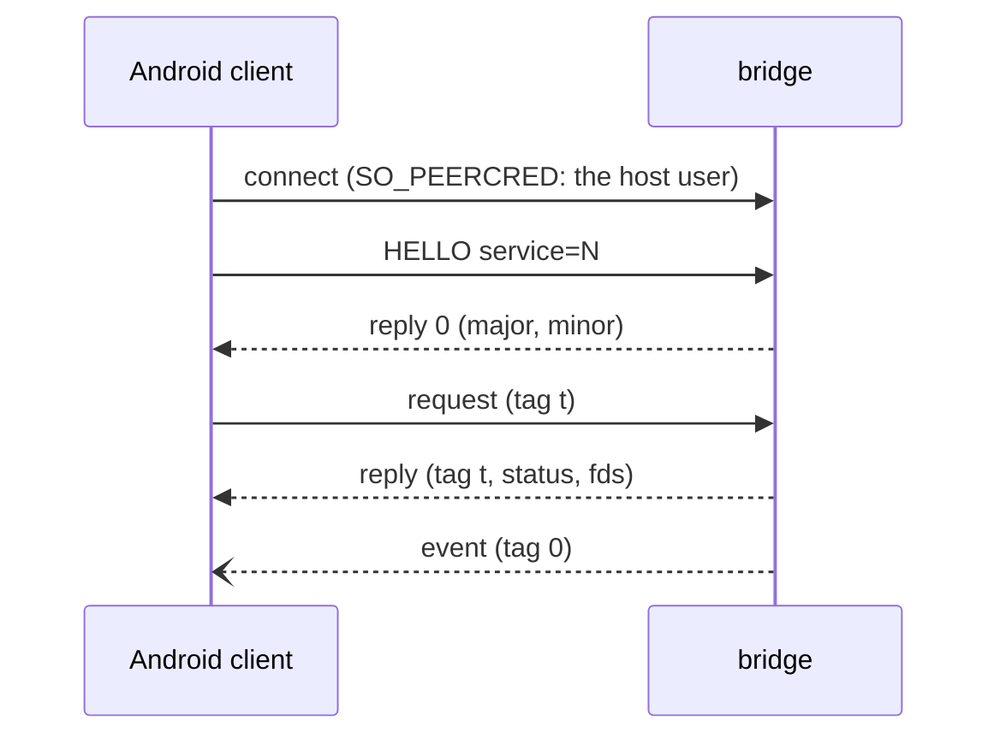

# Bridge protocol

`innkeeper-bridge` serves Android-side clients over one socket,
`$XDG_RUNTIME_DIR/innkeeper[-<profile>]/bridge/bridge.sock`, bound into Android
as `/dev/socket/innkeeper/bridge.sock`. This file is the cross-language spec;
each service's messages are in the module doc of its Rust `proto.rs`.

| Implementation | Where                                                                                             |
| -------------- | ------------------------------------------------------------------------------------------------- |
| Rust (server)  | [host/bridge/src/ipc](../host/bridge/src/ipc): `wire.rs`, `transport.rs`, `proto.rs`, `server.rs` |
| C (client)     | [guest/bridge-client](../guest/bridge-client/README.md), for the composers, audio and health      |
| Kotlin         | `Wire.kt` and `BridgeConnection.kt` in [android/system-app](../android/system-app/README.md)      |

`host/bridge/src/ipc/wire-fixtures.txt` and
`host/bridge/src/a11y/snapshot-fixture.txt` hold encodings that the Rust and
Kotlin tests both check.

## Framing

`AF_UNIX`, `SOCK_SEQPACKET`: one packet is one message, at most 512 bytes and 4
fds (`SCM_RIGHTS`). Integers are little-endian.

| Part   | Layout                                                             |
| ------ | ------------------------------------------------------------------ |
| header | `u16 type`, `u16 flags` (0), `u32 tag`                             |
| body   | type-specific, at most 504 bytes                                   |
| name   | `u16 len` (≤ 96) + UTF-8, no NUL or control characters             |
| reply  | type `0x8000`, the request's tag, `i32 status` (0 or -errno), body |

- Every request gets exactly one reply, in order; a reply may carry fds.
- Events (types `0x4000..=0x7fff`, tag 0) may arrive at any time. They never
  block the bridge: a client that doesn't read its socket loses them. Clients
  match replies by tag and treat events separately.
- Requests carry fds only where their service says so; any other request with
  fds gets them closed and `-EPROTO`.
- A malformed body gets `-EINVAL`, an unknown type `-ENOSYS`; the connection
  stays open. An unreadable header, a packet over 512 bytes or more than 4 fds
  ends it.
- Payloads that don't fit go as a sealed memfd (`F_SEAL_WRITE | SHRINK | GROW`)
  next to a small message carrying their length; the bridge reads them once with
  `pread` and never maps them.

## HELLO

| Type     | Body                                                  | Reply                    |
| -------- | ----------------------------------------------------- | ------------------------ |
| `0x0001` | `u16 major (1)`, `u16 minor (0)`, `u32 service`, name | `u16 major`, `u16 minor` |

HELLO is the first message and binds the connection to one service; a client
that needs two services opens two connections. A wrong major gets `-EPROTO`, an
unknown service `-ENOSYS`, and any other first message `-EPROTO`; each closes
the connection.

## Services

| Id  | Service   | Types / events      | Clients (Android side)                  | Spec                                                                 |
| --- | --------- | ------------------- | --------------------------------------- | -------------------------------------------------------------------- |
| 1   | audio     | `0x01xx`            | `libtinyalsav2` in the audio HAL        | [audio/proto.rs](../host/bridge/src/audio/proto.rs), `audio/ring.rs` |
| 2   | display   | `0x02xx` / `0x42xx` | the composers (Android, OpenHarmony)    | [display/proto.rs](../host/bridge/src/display/proto.rs)              |
| 3   | system    | `0x03xx` / `0x43xx` | the system app (integration)            | [system/proto.rs](../host/bridge/src/system/proto.rs)                |
| 4   | documents | `0x04xx` / `0x44xx` | the system app (picker, provider)       | [documents/proto.rs](../host/bridge/src/documents/proto.rs)          |
| 5   | apps      | `0x05xx`            | the system app (app mirror)             | [apps/mod.rs](../host/bridge/src/apps/mod.rs)                        |
| 6   | input     | `0x06xx` / `0x46xx` | the system app only (WM, injector, IME) | [input/proto.rs](../host/bridge/src/input/proto.rs)                  |
| 7   | a11y      | `0x07xx` / `0x47xx` | the system app only (accessibility)     | [a11y/proto.rs](../host/bridge/src/a11y/proto.rs), `a11y/wire.rs`    |
| 8   | hoststate | `0x08xx` / `0x48xx` | the Health HAL, the system app          | [hoststate/proto.rs](../host/bridge/src/hoststate/proto.rs)          |

Who may open which service: [security.md](security.md#the-bridge-socket).

## Android → desktop handoff

System request `0x030a` (PLAYBACK_APP) names the app on Android's one mixed
playback stream, so the desktop mixer (GNOME Settings, pavucontrol, Plasma's
volume applet) shows that app instead of a generic Innkeeper entry. Body: a
package name, then the app's label, each a protocol name (`u16` length plus
UTF-8, at most 96 bytes, no control characters). An empty package means nothing
is playing, and the bridge writes the name, icon and id the stream was opened
with (`Innkeeper`, `android`, `dev.sargunv.innkeeper`) back onto it, and clears
`application.process.binary`, which the open does not set. The label may be
empty; the bridge then shows the package. Android mixes every app into that one
stream, so this is a label for the newest app that is currently playing, not a
separate stream per app.

System request `0x0309` (HANDOFF) carries the portal operations beyond `0x0305`
OPEN_URI. Body: `u32 window`, `u8 action` (1 URI, 2 open file, 3 save file, 4
compose email), `u8 files` (0–3), `u8 ask` (boolean), `u8 0`, `u32 metadata_len`
(1–65536). Fds: a sealed metadata memfd, followed by exactly `files` readable
regular-file fds. Metadata is `u32 version` (1), text (≤32 KiB), subject (≤4
KiB), and one filename (≤255 bytes) per content fd; strings are `u32 length`
plus UTF-8. Filenames cannot contain `/` or be `.`/`..`. URI operations require
zero files and validate external schemes, rejecting `file:`, `content:`,
`intent:`, `javascript:` and `data:`. `mailto:` is allowed.

The reply acknowledges scheduling, not completion of a desktop dialog. The
bridge logs portal cancellation/failure. Four operations may wait for portals;
the five-per-ten-second rate limit also applies. Content is capped at 64 MiB per
file and copied to real files under the profile's cache directory. OpenURI
OpenFile uses `ask` for the desktop chooser; SaveFile writes only to the
portal-selected destination; Email uses `attachment_fds`. Opened files and
attachments stay until session shutdown (256 MiB retained cap); save copies are
removed after completion. Crash leftovers are reaped at the next handoff.

The bridge obtains a fresh xdg-activation token from the source Wayland
connection and supplies it to the portal; xdg-foreign supplies the parent.
Text-only open/save creates a `.txt` file; text-only email creates a draft body.
Text Copy uses the clipboard protocol.

## Clipboard blobs

System `CLIP_SET` (`0x0304`) and `CLIP` (`0x4303`) share the envelope
`u8 kind, u8 sensitive, u16 reserved=0, u32 blob length`, with one sealed memfd.
Kinds are 1 (raw UTF-8 text, 1 MiB), 2 (u16 width/height plus RGBA8, 16 MiB),
and 3 (1–16 files, 16 MiB total including metadata). The file blob starts with
`u32 file count`, followed by that many records: `u32 name length` plus UTF-8
name (1–255 bytes, no path separators), `u32 MIME length` plus MIME (1–255
bytes), then `u32 byte count` and raw bytes (at most 16 MiB minus 1024). No
trailing bytes are accepted. The system app exposes incoming bytes through a
read-only `content://dev.sargunv.innkeeper.system.clipboard.files/…` URI per
item and lets ClipboardService grant the pasting app access.

## Versioning

Minor versions only add message types or trailing reply fields, and clients
ignore reply bytes they don't know. A new major version means a new HELLO.

## Adding a service

1. Take an id below 64 in `ipc::proto::service`. Requests use `0xNN01..=0xNNff`
   and events `0x40NN`-style ranges (NN = the id); the core answers types at or
   above `0x4000` with `-EPROTO`.
2. Write `<service>/proto.rs`: `decode` built only on `wire::Reader` and ending
   with `Reader::end()`, `encode` for tests, and the message table as its module
   doc. Bound every count and length, read names with `Reader::name`,
   range-check floats, require reserved fields to be 0, and add proptests
   (arbitrary bodies never panic; accepted bodies re-encode to the same bytes).
3. Implement `server::Service::handle(ty, body, fds)`. It runs on the
   connection's thread, so hand long work to your own threads. Close fds you
   don't expect, and check the ones you do (`fstat`, seals, size) before mapping
   them. Put per-client caps in the service.
4. Send events with `server::Events::try_send`, which never blocks.
5. Register the factory in `main.rs`.
6. Shared memory you hand out is created and sealed by the bridge; never read
   back state you own from it, and clamp what the client writes there.

## Desktop session API (version 1)

The bridge owns `dev.sargunv.Innkeeper.Session` on the desktop session bus,
inside the Flatpak app-id namespace. A named profile owns
`dev.sargunv.Innkeeper.Session.p_<profile>` (hyphens become underscores). The
object is `/dev/sargunv/Innkeeper/Session`, interface
`dev.sargunv.Innkeeper.Session1`. Manager and CLI calls use this interface for
per-app management; they do not run commands inside Android. Starting a stopped
session still uses the launcher.

`State() → (b booted, as open_packages)` reads a snapshot without starting
Android. Name ownership means the bridge is running; `booted` means the system
app has observed `sys.boot_completed=1`, matching `Session::booted()`. The apps
channel connecting alone does not mean Android has completed booting.
`open_packages` lists packages whose windows are mapped by the display bridge.
`Changed()` invalidates this snapshot on boot completion, apps channel
connect/disconnect or window map/unmap. Consumers watch name ownership as well,
clearing state when the bridge exits, subscribe before reading, and read again
on each signal.

The system app sends apps request `0x0505` (BOOT_COMPLETED, empty body, no fds)
after receiving Android's boot-completed broadcast and checking the property. It
also checks and replays this on every connection for a late process start or
reconnect. A replacement or disconnected apps channel clears `booted` until the
current connection reports completion; an obsolete connection cannot set it.

`App(s package, s action, s permission, b enabled) → s response` is synchronous.
Actions are `info`, `clear-cache`, `clear-data`, `force-stop`, `permission`,
`escape-back` and `background`. Only `permission` accepts a permission name;
only the last three accept `enabled=true`. Unknown actions, malformed package or
permission names and unused fields fail with `InvalidArgs`. Disconnection, full
queues and a 20-second response timeout fail with `Failed`; after a timeout,
refresh before retrying because Android may have completed the operation.

The response is UTF-8 JSON (at most 64 KiB): `{"error":"", "info":{…}}` on
success, or `{"error":"message", "info":null}` on Android failure. `info`
contains `app_bytes`, `data_bytes` (including cache), `cache_bytes`,
`escape_back`, `background`, and `permissions`: objects with `name`, `granted`
and `editable`. Byte counts come from Android StorageStatsManager. Only
requested dangerous permissions are included; system/policy-fixed permissions
and legacy app permissions are read-only. Android enforces grant dependencies
and restrictions; failures return to the caller. Only installed user apps can be
changed. Cache/data clearing waits for Android's package-data callback; clear
data deletes the target's accounts, files and settings.

The system app's **apps** connection receives event `0x4501`:
`u64 request_id, u32 length`, plus one sealed JSON memfd. The command is
`{"package":"…","action":"…","permission":"…","enabled":false}`. It answers with
request `0x0504`, the same envelope and one sealed response memfd. No trailing
envelope bytes or extra fds are accepted. Both JSON payloads are capped at 64
KiB. Up to eight requests may wait; the system app serializes operations on its
apps worker. A reconnect cancels pending requests and stale responses are
ignored.

Escape-as-Back is stored per package in the system app's device-protected
preferences, default off. Input resolves the `innkeeper:<package>` display on
each new key press. Changes apply to existing windows immediately, while a held
key retains its original code through release. Background uses the lifecycle
allow-list and prompts a fresh activity report.

CLI examples: `innkeeper app org.example.app`,
`innkeeper app org.example.app clear-cache`,
`innkeeper app org.example.app escape-back --setting on`, and
`innkeeper app org.example.app permission --permission android.permission.CAMERA --setting off`.

`GetPreferences() → s json` reads the profile's persisted Innkeeper preferences.
`SetPreferences(s json)` validates and atomically replaces them, then broadcasts
the filtered desktop settings. The JSON object (at most 4096 bytes) has boolean
fields `follow_dark`, `follow_accent`, `follow_locale`, `follow_clock`,
`keep_running`, `mirror_apps`, `microg`, and integer `idle_minutes` (1–120).
Missing fields take their defaults: all following, mirroring and the installed
microG addon on, keep-running off, timeout 2 minutes. Unknown fields or invalid
values fail with `InvalidArgs`. Persistence failures return `Failed`. The
manager can also save these preferences while the session is stopped.

The desktop client obtains Background portal permission before enabling
`keep_running`, setting `autostart` with the session launcher's `start` command;
it removes autostart when switching back to an idle timeout. No autostart file
is written directly. The launcher re-reads the timeout while running, and only
includes the microG addon on the next start if enabled. Enabling mirroring asks
the system app to rescan launchable user apps with event `0x4502` (empty body,
no fds). Disabling it leaves existing launchers in place.

In `SETTINGS`, `has_accent=2` means leave Android's accent untouched (opted
out), `0` means the desktop has no accent, and `1` carries RGB. Other opted-out
values use their unspecified representation (dark/clock 0, locale strings
empty), so Android keeps its current values across opt-outs and restarts.
