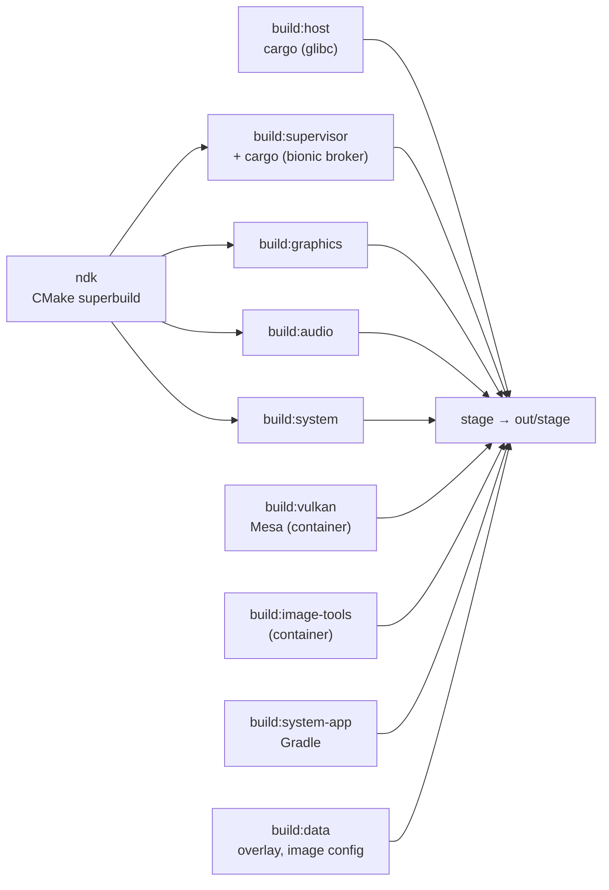

# Development

## Prerequisites

mise provides Rust (with the `x86_64-linux-android` target), Java, CMake, Ninja,
dprint, shellcheck, shfmt, hk and jactionlint (`mise install`). The rest comes
from the host; none of it needs root.

| For               | What                                                                                                                                                                                                       |
| ----------------- | ---------------------------------------------------------------------------------------------------------------------------------------------------------------------------------------------------------- |
| building          | Android SDK at `$ANDROID_HOME` (default `~/Android/Sdk`) with NDK `30.0.16248370`, build-tools `37.0.0` and `platforms;android-37.0`; podman; clang; GTK 4 (4.18+) and libadwaita (1.7+) development files |
| running a session | Flatpak, a Wayland desktop, GPU access (`/dev/udmabuf`) and audio; development sessions also use `systemd --user` and Python 3.11+                                                                         |

## Build

`mise run build` runs every `build:<module>` task, each into its own
`out/build/<module>/install` tree (paths relative to the prefix), then `stage`
merges them into `out/stage` and writes `share/innkeeper/manifest.tsv` (path,
module, sha256 per file). Stage fails if a module misses an artifact declared in
[tools/build/artifacts.toml](../tools/build/artifacts.toml) or two modules write
the same path. Nothing at runtime builds anything.



- **One toolchain pin**,
  [tools/build/toolchain.env](../tools/build/toolchain.env): mise loads it,
  container builds get it with `--env-file`, and Gradle reads it from the
  environment.
- **One NDK superbuild**, the root `CMakeLists.txt` (presets `android` and
  `host-tests`), builds every Android-side C/C++ artifact; each module installs
  its CMake component.
- **One build container**, [tools/container](../tools/README.md), for Mesa and
  the static image tools. Every run is capped (`--memory`, `--pids-limit`);
  those builds are skipped while their inputs hash to the same stamp.
- `mise run clean` removes build output and keeps test results.

## Run

- `mise run session -- start|stop|status|log|exec|shell|selftest|prepare` runs
  the staged launcher ([host/launcher](../host/launcher/README.md)) in a private
  Flatpak, capped from the host, with scratch HOME and XDG dirs under
  `out/dev/flatpak/<profile>` (default profile `dev`); it waits while less than
  25 GiB is available
  ([packaging/flatpak](../packaging/flatpak/README.md#development)).
- `tools/dev/innkeeper.sh install app.apk`, `run`, `uninstall`, `list`
  ([host/cli](../host/cli/README.md)) in the same Flatpak. It needs a desktop of
  its own: `INNKEEPER_PROFILE=cli tests/nested.sh tools/dev/innkeeper.sh list`
  runs it on a nested KWin with private PipeWire/Pulse (no hardware monitors), a
  private bus, AT-SPI bus, runtime dir and HOME/XDG dirs, and removes them
  after.
- `packaging/flatpak/build.sh` builds the Flatpak from the committed tree and
  installs it into `FLATPAK_USER_DIR`; use a private one under `out/`
  ([packaging/flatpak](../packaging/flatpak/README.md)).
- `mise run install-dev` builds and installs the committed Flatpak in the user
  installation, adding the manager to the app menu as an APK handler. Do this
  only for a checkout you mean to use as your Innkeeper; then
  `flatpak run dev.sargunv.Innkeeper install app.apk` uses it.
- Use `INNKEEPER_PROFILE=<name>` for anything experimental: it is a separate
  session with its own `/data`, logs and sandbox. Add `INNKEEPER_TEST=1` to keep
  it off the real desktop ([security.md](security.md#test-sessions)).

## Test

Test tiers and their mise tasks are in [tests/README.md](../tests/README.md).
`mise run check` (hk and dprint) is the pre-commit gate; `mise run fix` formats.

## adb into a profile

A profile can serve adb on loopback TCP, for Android Studio, Gradle and the
`adb` command line. It is off by default; turn it on per profile, at once if the
profile runs:

```sh
innkeeper profile set --adb on      # adb on: emulator-5556 (127.0.0.1:5557)
adb -s emulator-5556 install app.apk
```

- Each profile gets an adb port as the Android Emulator does: the first odd port
  from 5555 to 5585 whose pair (the console port, one below) nothing uses and no
  other profile has, kept in its settings (`debug-bridge-port`, which may also
  be set to any port). An adb server looks for devices there, so it lists the
  profile as `emulator-<port - 1>` with no `adb connect`, and so do Android
  Studio and Gradle. Use that serial: AGP 9.4.1's `connectedAndroidTest` fails
  for `host:port` serials even when every test passes.
- A running adb server finds a profile started after it once told, as the
  emulator tells it: `innkeeper adb` starts the profile if needed and announces
  it to the server (`ANDROID_ADB_SERVER_PORT`, default 5037), with no `adb` in
  the Flatpak. Restarting the server (`adb kill-server; adb devices`) finds it
  too.
- adb authentication stays on. The user's `~/.android/adbkey.pub` is authorized
  in the profile's data when adb is turned on, at each start and by
  `innkeeper adb`; `adb start-server` creates the key if there is none. Any
  other key is refused (`unauthorized`).

Run instrumented tests that take screenshots (`UiAutomation.takeScreenshot`,
screenshot-diff libraries) in phone mode (`innkeeper profile set --mode phone`).
In windowed mode each app window is its own virtual display, so a capture of the
default display does not show the app.

## Android logs

Take a bounded snapshot inside a named session:

```sh
INNKEEPER_PROFILE=debug mise run session -- exec timeout 10 logcat -b all -d -t 100
```

Without `-d` or `-t`, `logcat` streams until interrupted (`-T 100` streams too);
the timeout bounds a stalled reader.

- The `kernel` buffer is empty: logd can't read the host's `/proc/kmsg`. Init's
  `/dev/kmsg` writes go to the launcher instead (`session -- log`).
- There is no tracefs. libcutils turns atrace off when `trace_marker` fails to
  open, and `image/vendor.prop` silences the resulting per-process
  `cutils-trace` error (`log.tag.cutils-trace=S`).

## A nested, isolated desktop

Features that open windows, portals or notifications are tested in a nested
compositor that is fully isolated from the user's desktop: a private D-Bus
session, a private `XDG_RUNTIME_DIR` and XDG dirs under `out/`, `DISPLAY` unset,
and `WAYLAND_DISPLAY` set to the nested socket before the bus starts, so
whatever the bus activates (portals, kded) inherits it.

```sh
N=$PWD/out/nested
mkdir -p $N/{home,config,data,cache,state}
# A short runtime dir: a socket path must fit in 108 bytes, which a deep
# checkout's out/ can exceed (KWin then dumps core). Remove it when done.
RT=$(mktemp -d -p "$XDG_RUNTIME_DIR" inkp-XXXXXX)
printf '#!/bin/sh\necho "$DBUS_SESSION_BUS_ADDRESS" >%s/bus\nexec sleep infinity\n' $N >$N/hold.sh
chmod +x $N/hold.sh   # the session's command: publishes the nested bus, then waits
E=(-u DISPLAY -u WAYLAND_DISPLAY -u DBUS_SESSION_BUS_ADDRESS HOME=$N/home XDG_RUNTIME_DIR=$RT
   XDG_CONFIG_HOME=$N/config XDG_DATA_HOME=$N/data XDG_CACHE_HOME=$N/cache XDG_STATE_HOME=$N/state
   XDG_CURRENT_DESKTOP=KDE)
systemd-run --user --unit inkp-nested-kwin -p MemoryMax=3G -- env "${E[@]}" WAYLAND_DISPLAY=inkp-nested \
  dbus-run-session -- kwin_wayland --virtual --no-lockscreen --socket inkp-nested \
  --width 1920 --height 1080 --exit-with-session $N/hold.sh
WAYLAND_DISPLAY=$RT/inkp-nested DBUS_SESSION_BUS_ADDRESS=$(cat $N/bus) \
  INNKEEPER_PROFILE=nested mise run session -- start
# innkeeper writes desktop entries under XDG_DATA_HOME for every profile, so
# point it at $N while keeping the session's image and /data:
D=(XDG_DATA_HOME=$N/data XDG_CONFIG_HOME=$N/config INNKEEPER_PROFILE=nested
   INNKEEPER_IMAGES=$HOME/.local/share/innkeeper/images
   INNKEEPER_DATA=$HOME/.local/share/innkeeper/data-nested)
env "${D[@]}" out/stage/bin/innkeeper install some.apk
```

- Check `/proc/<pid>/environ` of every process on the nested bus (private
  `HOME`, nested `WAYLAND_DISPLAY`) before testing. Never start plasmashell,
  kded, akonadi or kdeconnect against the real dirs, and stop every unit you
  started when done.
- KWin's `org_kde_kwin_fake_input` gives real seat input. KWin offers it only to
  a client whose resolved executable (e.g. `/usr/bin/python3.14`, not the
  symlink) is the `Exec` of a `.desktop` file in `$N/data/applications` with
  `X-KDE-Wayland-Interfaces=org_kde_kwin_fake_input`. `spectacle -b -n` with the
  nested bus captures screenshots.
- Inside Android, plain `screencap` shows only the launcher: each app window is
  its own virtual display, named `innkeeper:<package>`. Capture one with
  `screencap -d <id> -p <file>`, taking the id from
  `dumpsys SurfaceFlinger --display-id`, as tests/compat does.
- A fake `x-scheme-handler/https` handler in `$N/data/applications` logs what
  OpenURI opens, and a null sink (`INNKEEPER_AUDIO_SINK`) keeps media silent.
