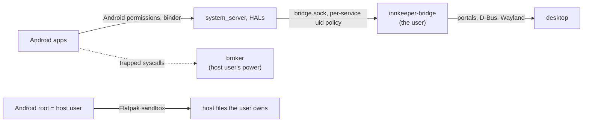

# Security

## Threat model: desktop parity

An Android app may do what a native desktop app running as the user can do.
Innkeeper adds no protection that costs complexity, hacks or performance beyond
that.

- **Kept:** isolation that comes from the Flatpak sandbox, and simple bounds and
  correctness checks (sizes, overflow, never writing into the wrong process).
- **Out of scope:** making host helpers robust against deliberately malicious
  Android processes, such as session-wide denial of service or kernel-exact
  fault semantics for malformed requests that only hurt the caller.
- **The outer boundary** is the packaging (Flatpak), as for any desktop app.

## Trust boundaries

- **Android root is the host user.** Inside the user namespace it has the user's
  file access, limited by the Flatpak sandbox:
  [session.md](session.md#host-safety) lists its grants and probes, and
  `selftest` proves them.
- **The supervisor** (the Rust broker) runs in the sandbox with the host user's
  privileges and reads and writes Android processes' memory. It serves only
  callers inside the session's seccomp filter. It keeps bounds checks and pins
  each process's memory at binder open so writes never land in the wrong
  process, but a process that misbehaves on purpose can stop binder for the
  whole session; that is accepted.
- **The bridge** runs as the user and talks to the desktop. Its socket is the
  only channel out of Android ([bridge-protocol.md](bridge-protocol.md)).

## The bridge socket

- The socket directory is linked into Android as `/dev/socket/innkeeper`,
  `root:audio 0750`; the system app gets the `audio` group through its
  `HOST_BRIDGE` permission.
- `SO_PEERCRED` is checked against the host user.
- The system app's uid (the owner of its data directory) is admitted to the
  system, documents, apps and hoststate services; `system` (the Health HAL)
  reaches hoststate through the allow-list. The **input and a11y services are
  the system app's alone**: input's lines are the user's keystrokes, and a11y's
  trees are every app's screen contents and its actions click for the user.
- One service per connection (HELLO); anything else gets `-EACCES` or `-EPROTO`
  and is closed.

## Single-uid mode

Every Android process is the same kernel uid, so **apps are not isolated from
each other**: any app can read or write another app's files and signal its
processes. Binder, PackageManager and AppOps still see the right virtual uids,
but that is policy enforced by Android's own processes, not by the kernel.

- This matches one desktop user running several native apps, which is the threat
  model. The CLI and manager show a one-time notice.
- Host supplementary groups are unmapped in the sandbox; `selftest` checks that
  no host group is mapped.
- **Accepted:** the bridge sees every Android process as the user, so its uid
  checks admit any app to every service, including input. That matches desktop
  parity: a native app running as the user can reach the same desktop services.

## Flatpak mode

The Flatpak sandbox is the boundary, as for any Flatpak app
([session.md](session.md#flatpak-mode)). `selftest` checks the sandbox's grants
and what it shows Android.

- **Network.** Android has no network namespace of its own: it uses the host's
  network, as a native app with `--share=network` does. netd's routing and
  firewall rules are accepted and ignored, so per-app network restrictions and
  traffic statistics don't exist, and data-usage and firewall apps can't work.
  There is no TUN device, so `VpnService` apps can't start a VPN. Both are
  accepted.
- **No cgroups.** Only single-uid mode exists, and a session has no memory cap
  of its own. Development and test sessions are capped from the host; the app
  gets no systemd permission.
- **Input devices.** `--device=input` lets the bridge open controllers the user
  can already access through uaccess ACLs, including rumble writes. It also lets
  every Android app read the host's input devices, keyboards and mice included,
  as any Flatpak with that grant could; this is accepted for controller support.
  EventHub scans the broker's private discovery directory so keyboard, mouse and
  controller routes aren't duplicated; that routing is not an access boundary.
  The grant needs Flatpak 1.15.6 or newer; Debian 13 ships 1.16.

The Flatpak's grants are `--device=dri`, `--device=input`, `--share=network`,
`--share=ipc`, `--socket=wayland`, `--socket=pulseaudio`, read-only
`~/.android/adbkey.pub` (for [adb](#desktop-exposure)), and these bus names, for
what the baseline portals and proxies lack:

- `org.a11y.Bus`: the baseline AT-SPI proxy hides the `org.a11y.Status`
  properties the bridge follows.
- the system bus's `org.freedesktop.UPower`: there is no battery portal.
- `org.freedesktop.Notifications`: the Notification portal can't update
  notifications in place or show progress.

MPRIS players own names under `org.mpris.MediaPlayer2.dev.sargunv.Innkeeper`,
which Flatpak grants every app for its own id. Links and files go through the
same portals as outside, and app-menu entries through the DynamicLauncher
portal, so the user confirms each one. Clipboard sync uses data control where
available (KWin), or the display connection while an Innkeeper window has focus
(GNOME).

## Desktop exposure

- **Links:** only absolute `http(s)` URLs, rate-limited, through the OpenURI
  portal.
- **Files:** Android reaches only what the user picked in the FileChooser
  portal, through opaque grants and `openat2(RESOLVE_BENEATH)`; the bridge is
  the only side that sees host paths.
- **Clipboard:** text, images and bounded file selections sync through
  `ext_data_control_v1`, or `wl_data_device` while an Innkeeper window has
  focus. File-manager copies use FileTransfer portal grants; plain file URIs can
  read only paths the Flatpak already has. Android file clips use private cache
  copies and read-only content URIs. Sensitive clips carry the password-manager
  hint. Test sessions disable both backends.
- **Notifications and MPRIS:** labels and images from apps; images are raw RGBA,
  so nothing Android sends reaches a host image decoder.
- **Accessibility:** while the desktop's assistive technologies are on
  (`org.a11y.Status`), the system app's accessibility service sends every app
  window's AccessibilityNodeInfo tree to the bridge, which shows it on the
  AT-SPI bus. Any AT-SPI client then reads the screen text of Android apps as it
  does that of native apps, and can act on them; password fields are masked.
  Otherwise the Android service stays off.
- **Desktop entries:** names, schemes and URIs from APKs are validated and
  escaped; `http(s)`, `file`, `content` and `intent` schemes are never
  registered.
- **Host state:** the battery (UPower), the power saver (the PowerProfileMonitor
  portal) and the network's metering (the NetworkMonitor portal) are read-only
  state any desktop app can read; every Android app sees them.
- **adb** is off per profile until the user turns it on. Then the image's adbd
  listens on a loopback port of the profile's own, with adb authentication on
  (`ro.adb.secure=1`): only keys in the profile's `/data/misc/adb/adb_keys` get
  in, where the user's `~/.android/adbkey.pub` is added, so other users of the
  host can't connect. The Flatpak reads only that public key, read-only. The
  image would otherwise start adbd at every boot on port 5555 without
  authentication; the overlay keeps it from starting (`usbd.rc`, `init.usb.rc`).
- **Location** has two consents. Android's runtime permission comes first: the
  bridge asks the Location portal only once an app Android allowed asks for a
  location, through one portal session for all of Android. If the user says no
  there, or location is off on the desktop, Android's location providers stay
  off until the bridge restarts, and apps keep their Android permission. If the
  portal is unavailable, Android gets no location.

## Test sessions

`INNKEEPER_TEST=1`, which every test harness sets, selects the bridge's
`--test-session` mode, persisted in `session.conf`. It leaves the user's desktop
alone, including when tests use a private bus: links, notifications and MPRIS
players are logged only, AT-SPI and location are off, and apps installed inside
Android get no desktop entries. Clipboard sync is disabled in both directions;
the bridge never connects to the compositor's clipboard. A documents PICK
immediately completes with `-ECANCELED` and no items, without opening the
FileChooser portal. The system service does not connect to the desktop's
Settings, PowerProfileMonitor or NetworkMonitor portals either. Battery readings
come from the caller's system bus (`DBUS_SYSTEM_BUS_ADDRESS`), which tests point
at mocks.
